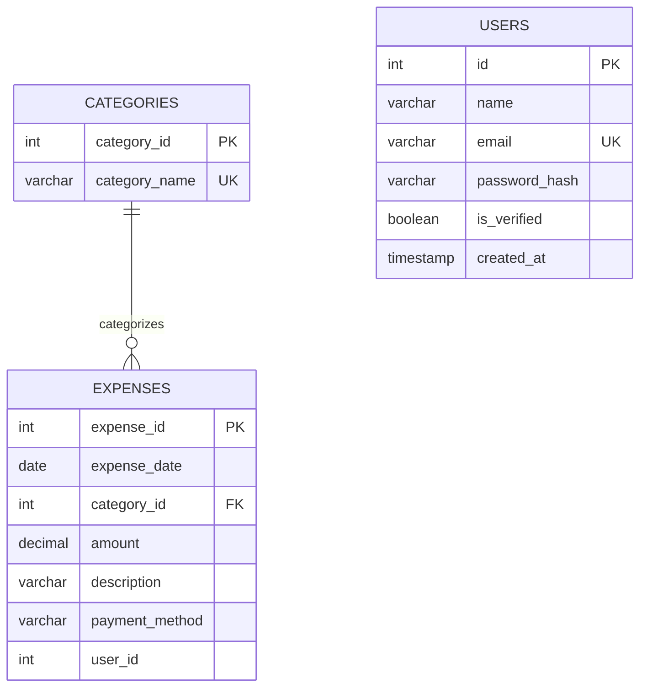

# Personal Expense Tracker — ER Diagram

## Entities

### 1. USERS
- **id** (Primary Key)
- name
- email (Unique)
- password_hash
- is_verified
- verification_token_hash
- verification_expires_at
- created_at

### 2. CATEGORIES
- **category_id** (Primary Key)
- category_name (Unique)

### 3. EXPENSES
- **expense_id** (Primary Key)
- expense_date
- category_id (Foreign Key → CATEGORIES.category_id)
- amount
- description
- payment_method
- user_id (Nullable; no foreign-key constraint verified)

## Relationships

- One category can be associated with many expenses.
- Each expense references a category through `category_id`.
- The `expenses.user_id` column stores a user ID, but a foreign-key constraint linking it to `users.id` has not been verified.

## Mermaid ER Diagram

